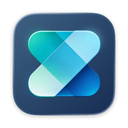
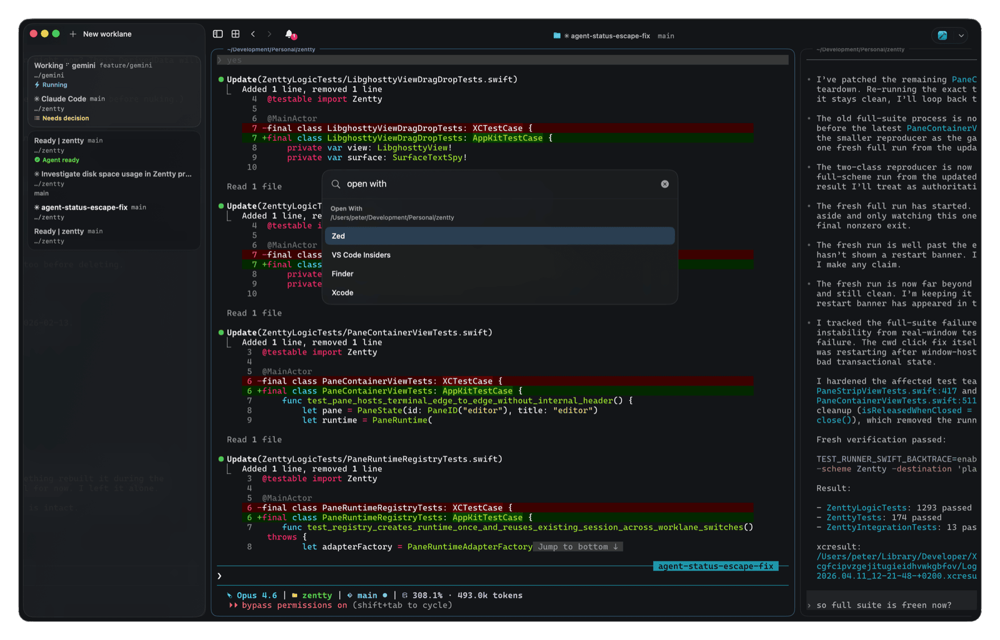

<!-- LOGO -->
<h1>
<p align="center">
  
  <br>Zentty
</h1>
  <p align="center">
    A native macOS terminal for agent-driven development, built on Ghostty.
    <br />
    Zentty gets out of the way. Minimal friction, maximum focus.
    <br />
    <a href="https://github.com/dedene/zentty/releases/latest/download/Zentty.dmg">Download</a>
    ·
    <a href="#install">Install</a>
    ·
    <a href="#status">Status</a>
    ·
    <a href="#build">Build</a>
    ·
    <a href="CONTRIBUTING.md">Contributing</a>
  </p>
</p>

<p align="center">
  
</p>

## Features

**Layout**
- **Worklanes, not tabs.** A horizontally scrolling strip of columns, each a vertical stack of panes, borrowed from niri and Hyprland. Drag, resize, and rearrange without losing your place.
- **Keyboard-first.** Every action is a command, every command is bindable, and a fuzzy command palette catches whatever you forgot. Ghostty-compatible shortcuts out of the box.
- **Visual pane switcher.** Hold Ctrl+Tab to zoom out and pick a pane. ⌘⇧T reopens the pane you just closed.
- **Restore everything.** Worklanes, sidebar, pane output, and agent sessions come back on relaunch. Closed mid-task? Zentty resumes the agent, or reruns your last shell command.

**Agents**
- **Agent-aware sidebar.** Agents report status into the sidebar: working, waiting, asking for approval, compacting. You see who needs you without switching panes.
- **Subagents and teams.** A badge shows how many subagents are running and which models they use. Parents stay visible while background work continues.
- **Menu bar status.** Agent state lives in the macOS menu bar, so you know who needs you even when Zentty is hidden.
- **1Password prompts point home.** When `op` or ssh-agent asks for approval, Zentty tells you which pane triggered it and can jump there.
- **Stays awake.** Zentty caffeinates the Mac while an agent is running.
- **Fork a conversation.** Branch an agent's conversation into a new pane with its own fork command while the original keeps going.

Supported agents: Amp, Antigravity, Claude Code, Codex, Copilot CLI, Cursor, Devin, Droid, Gemini CLI, Grok Build, Hermes Agent, Kimi, Mistral Vibe, Muse Code, Oh My Pi, OpenCode, Pi, and Small Harness. Any other tool can join via the [Agent Status Protocol](docs/agent-status-protocol.md).

**Projects**
- **Dev servers and PRs in the sidebar.** Running localhost servers show as clickable ports. Panes on a branch with a PR show its checks and review state.
- **Task runners.** Detects package.json scripts, Makefiles, justfiles, Taskfiles, and mise tasks, and runs them from the palette.
- **Global search.** Search inside a pane or across every worklane from one shortcut.

**Remote and terminal**
- **Paste files into ssh sessions.** Drop an image, PDF, or archive on a remote pane and Zentty uploads it over the existing ssh connection and pastes the remote path.
- **Status from any program.** A build, test run, or remote script can show progress, an error, or a pause in the sidebar by printing the standard OSC 9;4 progress sequence. See [Program Status](docs/program-status.md).
- **Clean copy.** Copy agent output without prompts, box drawing, and tracking params. Copy as Markdown keeps the structure.
- **Native Ghostty themes.** Built-in picker with live preview, opacity, and blur. Fine without Ghostty installed too.
- **Built on libghostty.** GPU rendering in a native Swift and AppKit shell. No Electron, no web views.
- **Scriptable.** Drive worklanes and panes, type into them, read their screens, and stream agent and pane events from the embedded `zentty` CLI.

See [Zentty CLI](docs/cli.md) for command-line usage.

See [Configuration and Syncing](docs/configuration.md) for where settings live and how to share them between Macs.

## Agent Skill

Agents can install the Zentty CLI skill to discover pane-aware commands while running inside Zentty:

```bash
npx skills add dedene/zentty
```

## Install

With [Homebrew](https://brew.sh):

```bash
brew install --cask zentty
```

Or download the latest `.dmg` from the [releases page](https://github.com/dedene/zentty/releases/latest), open it, and drag Zentty to your Applications folder.

Zentty updates itself in place via [Sparkle](https://sparkle-project.org) once installed. No need to check back here for new versions.

Builds are signed and notarized by Zenjoy BV. Requires macOS 14 (Sonoma) or later.

## Status

Zentty is in active development. Expect rapid iteration, rough edges, and occasional breaking changes while the project is opened up.

## Requirements

- macOS 14 (Sonoma) or later
- Xcode
- `zig` on `PATH`
- `gettext` on `PATH`

## Build

Zentty requires a local `GhosttyKit.xcframework` before the app can build normally.

Build the framework:

```bash
./scripts/build_ghosttykit.sh
```

Then build the app:

```bash
xcodebuild -project Zentty.xcodeproj -scheme Zentty -destination 'platform=macOS' build
```

If you need to regenerate the Xcode project from [`project.yml`](project.yml):

```bash
bundle exec fastlane mac generate_project
```

### Dependencies

Swift package versions are pinned in `Zentty.xcodeproj/project.xcworkspace/xcshareddata/swiftpm/Package.resolved`, which is committed. The version ranges in `project.yml` say what is allowed; the resolved file says what actually ships. Release builds run with automatic package resolution disabled, so they fail rather than drift when the pins no longer satisfy the ranges.

To bump a dependency, update the range in `project.yml` if needed, then resolve and commit the new pins:

```bash
xcodebuild -resolvePackageDependencies -project Zentty.xcodeproj -scheme Zentty
git add Zentty.xcodeproj/project.xcworkspace/xcshareddata/swiftpm/Package.resolved
```

The release lane builds Sparkle's `generate_appcast` from the pinned Sparkle revision. It reuses a checkout that already sits at that revision (the release build's `build/SourcePackages`, or Xcode's DerivedData) and otherwise clones it into `build/sparkle-tools`. `bundle exec fastlane mac build_generate_appcast` builds the tool on its own.

More detail about the Ghostty bootstrap flow lives in [`docs/ghosttykit-setup.md`](docs/ghosttykit-setup.md).

## Test

Run the full test suite:

```bash
ZENTTY_TEST_DISPLAY_PROVIDER=betterdisplay scripts/test-on-virtual-display
```

## Agent Hooks

Zentty bundles helper commands and environment variables for agent-aware workflows inside terminal panes.

Hook configuration details are documented in [`docs/agent-hooks.md`](docs/agent-hooks.md).

For Kimi specifically: do first-time auth with `kimi login` before using wrapped `kimi` inside Zentty. Zentty passthroughs Kimi's management commands directly to the real Kimi binary so login/logout keep using the default Kimi config. If you want a specific model, prefer `kimi --model <model-id>` or set `default_model` in `~/.kimi/config.toml` (or `~/.kimi-code/config.toml` for modern Kimi Code CLI).

## Contributing

Contributions are welcome. Start with [`CONTRIBUTING.md`](CONTRIBUTING.md).

Before a non-trivial contribution can be merged, contributors must agree to [`CLA.md`](CLA.md).

## License

Zentty is available under the GNU General Public License v3.0 only (`GPL-3.0-only`). See [`LICENSE`](LICENSE).

If your organization cannot or does not want to comply with GPLv3, alternative commercial licensing may be available from Zenjoy BV. Contact `hallo@zenjoy.be`.

## Trademarks

The GPL license covers the code. It does not grant rights to use the Zentty name, logos, icons, or other branding for your own distribution.

See [`TRADEMARKS.md`](TRADEMARKS.md) for branding rules.
